# Manga Color Layer · 漫画上色与动画分层 Skill

参照彩色图为漫画线稿上色，并将角色整理成适合 After Effects 木偶工具等轻量动效的 PSD / 透明 PNG 图层。

本项目是一套面向 AI 助手的工作流程、检查原则和辅助脚本，来自多轮实际制作与反馈整理。它不是独立的上色模型，也不是“一键生成可用 Live2D 模型”的软件。图像理解、局部补画和检查仍需要具备相应工具能力的 AI 助手参与。

## 简介与用途

- **参考图上色**：辨认皮肤、头发、服饰、饰品和道具的归属，保留原漫画的线稿、网点、姿态、表情和材质关系，减少不必要的重绘与串色。
- **角色动画分层**：根据实际需要的呼吸、头部轻动、头发摆动等动作选择分层，优先保证完整连续和遮挡合理。
- **遮挡补画**：补全被头发、衣物和其他前景遮挡的区域，处理边界、残留线稿、色差和透明孔洞。
- **面部独立控制**：按需要准备眉毛、眼白、虹膜、上下眼皮、泪水、嘴部及眨眼替换形状，保留原有眼神与表情。
- **检查与导出**：对照上色图检查静态组合，逐层检查隐藏表面，再做小范围独立、组合和反向运动检查。

仅需上色时可只执行上色流程；已有彩图时也可只做分层。分层数量不是质量指标：难以稳定拆分、且不需要独立运动的部位应合并。

## 效果演示

以下示例展示金发女仆角色的参考配色与分层结果。示例画稿和角色的权利归各自权利人；此处用于非商业效果交流，不构成对原作素材的授权。

### 原图与上色（分层前）

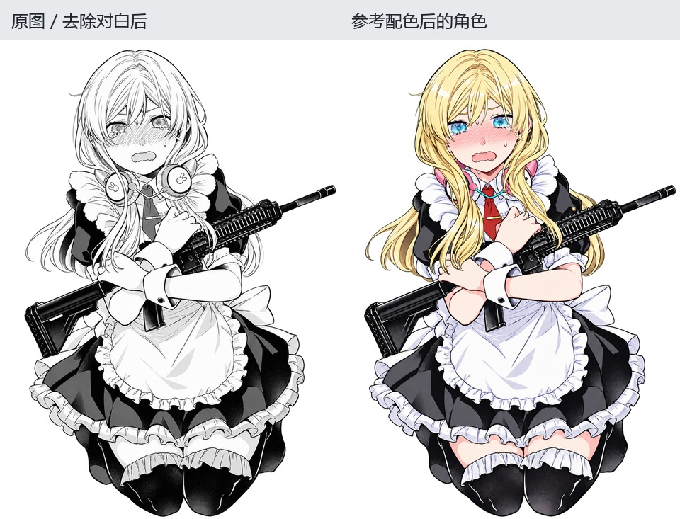

上图右侧使用的是[分层前确认的上色图](examples/blonde-maid/blonde-maid-color-master.png)，不是 PSD 的静态重组图。它是上色阶段的结果，也用于后续分层效果对比。

### 分层后的静态组合


上图来自分层结果的默认组合，包含后续遮挡补画和局部边界整理。它用于展示分层交付效果，不能替代分层前的上色结果。

### 前发细化拆分

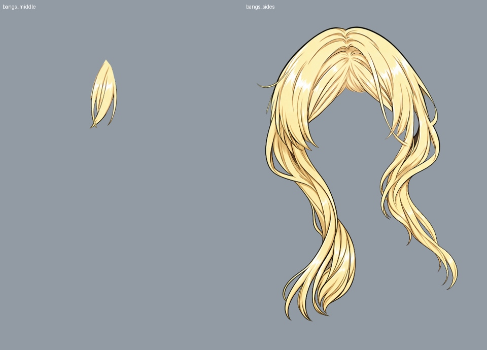

此例前发保留两个图层：中刘海，以及包含完整遮挡补画的左右刘海。没有额外拆出头顶层；其他已确认的眼部、嘴部、后发和身体图层继续保留。

### 全部拆分图层（19 层）

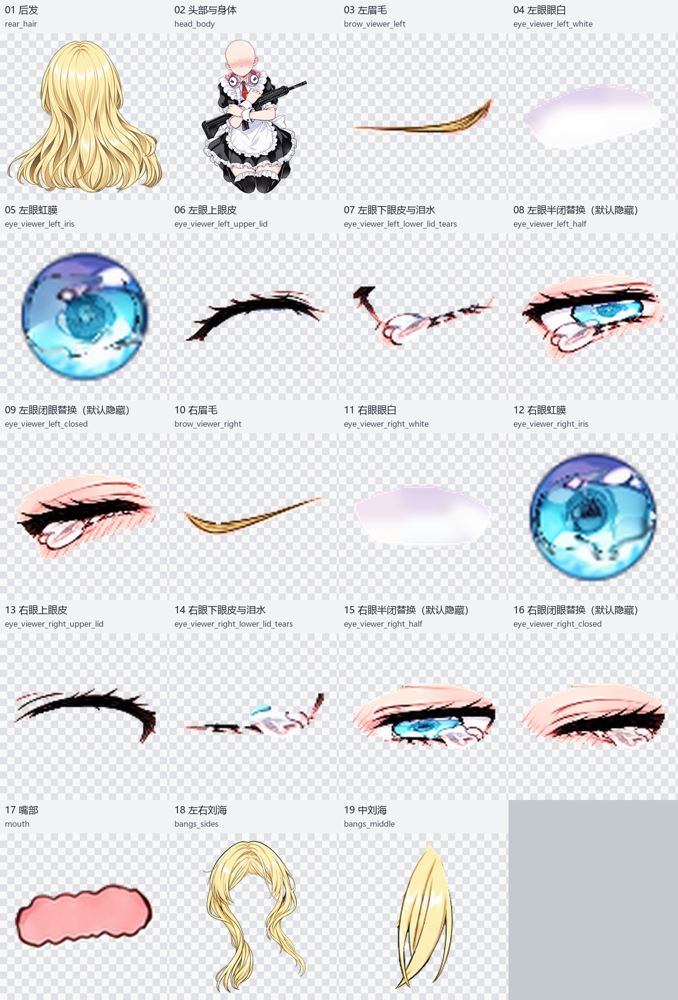

以下包含全部图层，左右按画面方向命名。四个半闭眼/闭眼替换层在默认组合中隐藏，也全部列出。展示卡片仅裁去透明留白并缩放方便检查；原始 PNG 仍保持统一画布、坐标和透明背景。点击卡片可打开对应原始 PNG。

<details>
<summary>展开逐层查看全部 19 层</summary>

| 图层 | 图层 | 图层 |
| --- | --- | --- |
| **01 后发**<br>[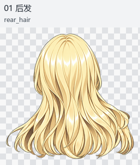](examples/blonde-maid/layers/blonde-maid-01_rear_hair.png) | **02 头部与身体**<br>[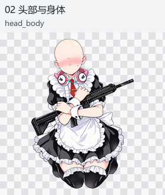](examples/blonde-maid/layers/blonde-maid-02_head_body.png) | **03 左眉毛**<br>[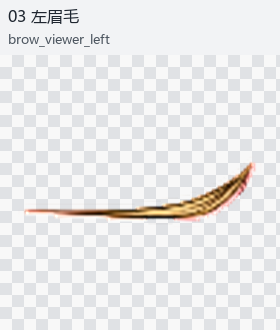](examples/blonde-maid/layers/blonde-maid-03_brow_viewer_left.png) |
| **04 左眼眼白**<br>[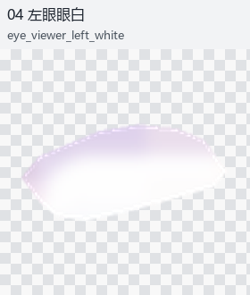](examples/blonde-maid/layers/blonde-maid-04_eye_viewer_left_white.png) | **05 左眼虹膜**<br>[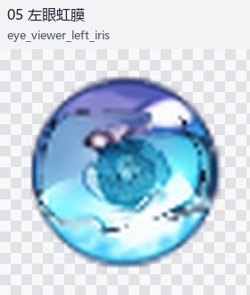](examples/blonde-maid/layers/blonde-maid-05_eye_viewer_left_iris.png) | **06 左眼上眼皮**<br>[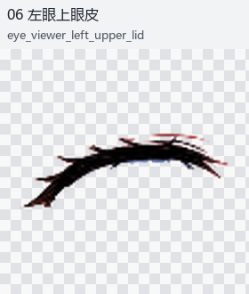](examples/blonde-maid/layers/blonde-maid-06_eye_viewer_left_upper_lid.png) |
| **07 左眼下眼皮与泪水**<br>[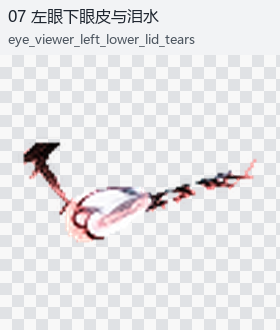](examples/blonde-maid/layers/blonde-maid-07_eye_viewer_left_lower_lid_tears.png) | **08 左眼半闭替换（默认隐藏）**<br>[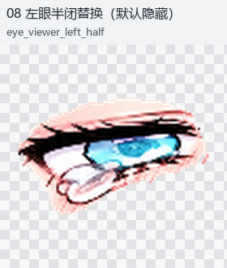](examples/blonde-maid/layers/blonde-maid-08_eye_viewer_left_half.png) | **09 左眼闭眼替换（默认隐藏）**<br>[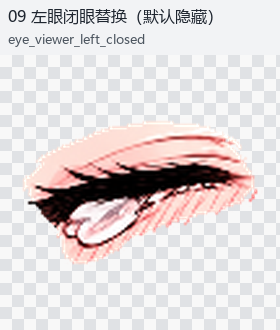](examples/blonde-maid/layers/blonde-maid-09_eye_viewer_left_closed.png) |
| **10 右眉毛**<br>[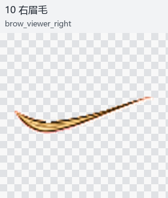](examples/blonde-maid/layers/blonde-maid-10_brow_viewer_right.png) | **11 右眼眼白**<br>[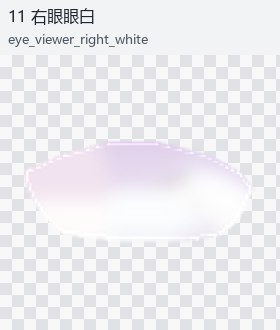](examples/blonde-maid/layers/blonde-maid-11_eye_viewer_right_white.png) | **12 右眼虹膜**<br>[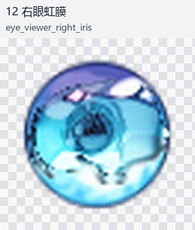](examples/blonde-maid/layers/blonde-maid-12_eye_viewer_right_iris.png) |
| **13 右眼上眼皮**<br>[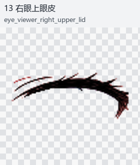](examples/blonde-maid/layers/blonde-maid-13_eye_viewer_right_upper_lid.png) | **14 右眼下眼皮与泪水**<br>[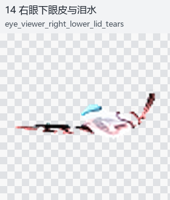](examples/blonde-maid/layers/blonde-maid-14_eye_viewer_right_lower_lid_tears.png) | **15 右眼半闭替换（默认隐藏）**<br>[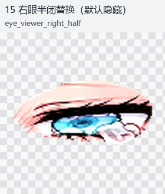](examples/blonde-maid/layers/blonde-maid-15_eye_viewer_right_half.png) |
| **16 右眼闭眼替换（默认隐藏）**<br>[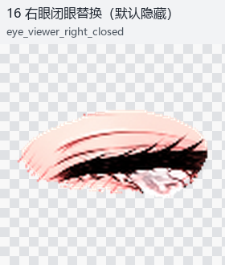](examples/blonde-maid/layers/blonde-maid-16_eye_viewer_right_closed.png) | **17 嘴部**<br>[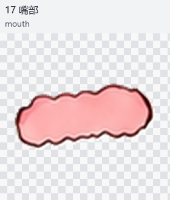](examples/blonde-maid/layers/blonde-maid-17_mouth.png) | **18 左右刘海**<br>[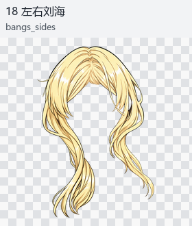](examples/blonde-maid/layers/blonde-maid-18_bangs_sides.png) |
| **19 中刘海**<br>[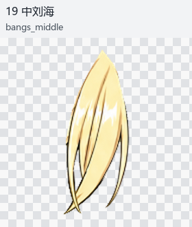](examples/blonde-maid/layers/blonde-maid-19_bangs_middle.png) |  |  |

</details>

### 小幅运动与眨眼形状


GIF 为小幅发束形变检查：侧发自由端水平约 ±4 像素，中刘海约 ±1.8 像素，根部保持约束。它不是 AE 运行录像，也不是完整 Live2D 模型演示。

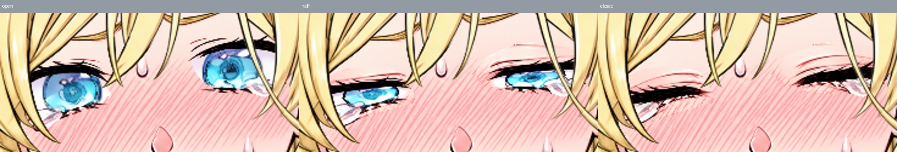

上图展示拆分保留的眨眼替换形状，实际动画仍需在目标软件中设置。

### 下载示例

- [完整素材 ZIP](examples/blonde-maid/blonde-maid-assets.zip)：包含 PSD、对齐透明 PNG、导入文件和检查资料。
- [分层 PSD](examples/blonde-maid/blonde-maid-layers.psd)（约 12 MB；打开 GitHub 文件页后选择下载）。
- [分层前上色图](examples/blonde-maid/blonde-maid-color-master.png)。
- [分层后静态组合 PNG](examples/blonde-maid/blonde-maid-colored.png)。
- [逐层 PNG 和坐标信息](examples/blonde-maid/)。

示例放在 `examples/`，不属于运行 skill 的必要依赖；只安装技能的用户可以不保留该目录。ZIP 下载页中选择下载原始文件即可获取完整压缩包。

### 更多角色分层示例

以下图片展示的是**分层后的静态组合**和全部部件；这里没有将静态组合标作分层前上色图。它们是既有制作成果的发布整理，本次未重跑图像生成或 AE/Cubism 绑定。

#### 青发角色（图 1，11 层）


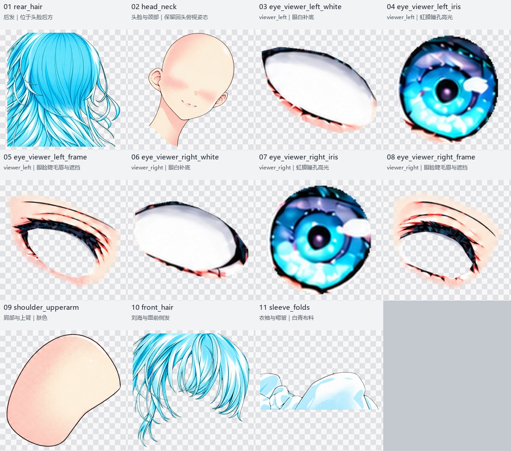

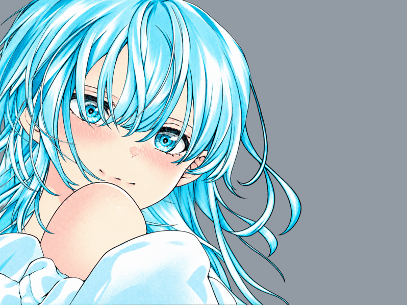

示例保留前后发、肩部与衣袖、左右眼的眼白/虹膜/眼睑遮挡等独立层。衣袖与肩部保持接触，不支持任意拉开；原有本地检查范围及限制见[制作说明](examples/cyan-character/README.md)。

[完整素材 ZIP](examples/cyan-character/cyan-character-assets.zip) · [分层 PSD](examples/cyan-character/character-layers.psd) · [逐层透明 PNG](examples/cyan-character/layers/)

#### 红发角色（14 层）


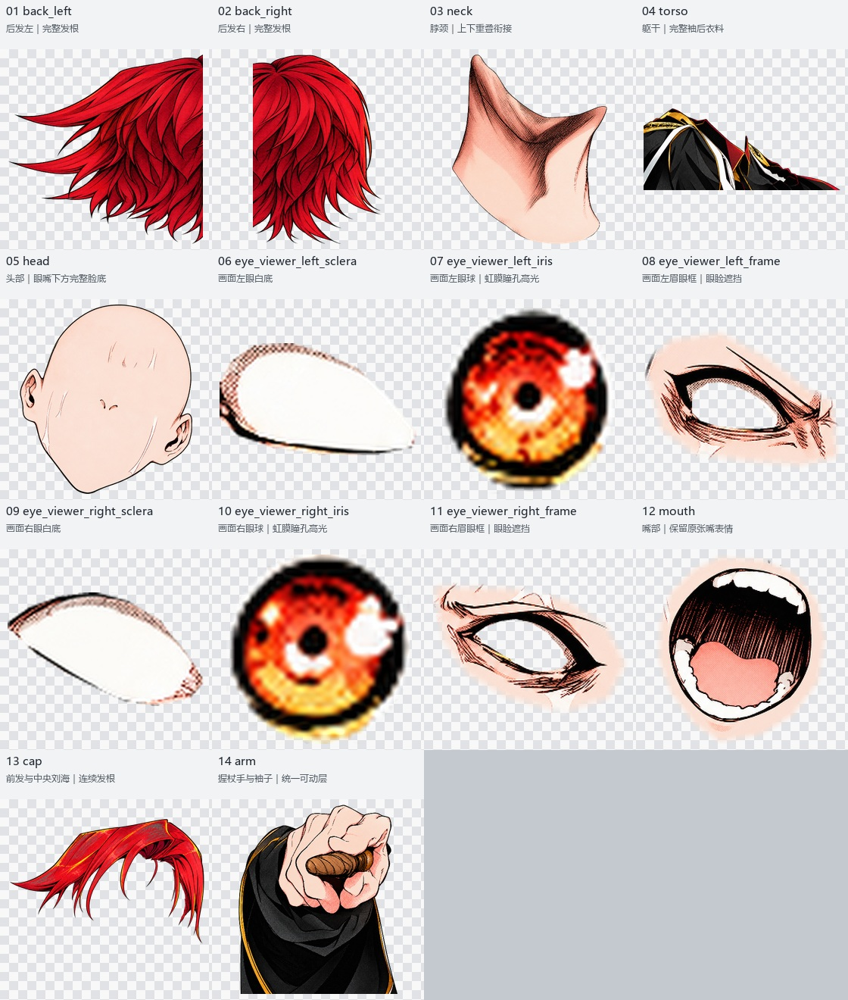

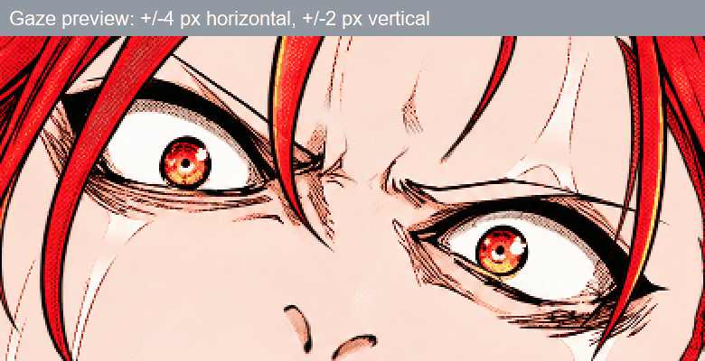

示例包含头发、头脸颈、躯干、嘴部、握持道具的手袖，以及左右眼的眼白、虹膜和眉眼框。视线预览为本地检查，没有完整眨眼或口型绑定；详见[示例说明](examples/red-character/EXAMPLE-NOTES.md)。

[完整素材 ZIP](examples/red-character/red-character-assets.zip) · [分层 PSD](examples/red-character/character-layers.psd) · [逐层透明 PNG](examples/red-character/layers/)

## 安装

### 方法一：通过 Skill Installer

在支持该功能的 Codex 环境中发送：

```text
$skill-installer 请安装 https://github.com/CHAOSze/manga-color-layer 中根目录的 skill，名称使用 manga-color-layer。
```

### 方法二：作为项目 skill 手动安装

在目标项目目录执行：

```sh
git clone https://github.com/CHAOSze/manga-color-layer.git .agents/skills/manga-color-layer
```

确认 `.agents/skills/manga-color-layer/SKILL.md` 存在。该位置已安装同名 skill 时，先检查已有内容，避免重复安装或覆盖自己的修改。未显示时可重启 Codex。

技能加载位置与安装行为请以 [OpenAI 官方技能文档](https://learn.chatgpt.com/docs/build-skills) 为准。其他支持 Agent Skills 的工具，可按照各自的技能安装方式加载此目录；其图像工具与导出能力可能不同。

## 使用方法

### 1. 准备素材与目标

提供以下信息：

- 原始漫画图或线稿；如仅做分层，提供确认过的彩图。
- 彩色参考图，并说明它用于配色、风格还是造型判断。
- 需要的动作、可接受的动作范围，以及需要独立控制的部位。
- 输出格式、保存目录；可附上分层 PSD 作为结构参考。

上传的 PSD 是拆分思路的参考，不要求机械复制其图层数量。含对白或其他遮挡物时，应明确是否需要移除及补画。

### 2. 调用示例

```text
请使用 $manga-color-layer。
根据参考彩图给这张漫画上色，尽量保留原线稿、网点、姿态和表情。
制作适合漫画镜头动效的分层：头发轻摆、呼吸、眨眼和小范围视线移动。
优先输出分层 PSD，同时提供对齐的透明 PNG、图层说明和适用的 AE 导入文件。
不好拆分、又不需要独立运动的部位可以合并；补齐运动时可能露出的遮挡区域。
先对比原图检查上色，再对比确认的彩图检查分层静态效果，最后检查小范围运动。
成果保存到 outputs/，文件名使用英文。
```

也可以只指定局部修复：

```text
使用 $manga-color-layer 修复现有 PSD。
中刘海已经确认，请保持不变。左右刘海保留为一个连续图层，修复其被中刘海遮挡的部分。
不要增加单独头顶层。对比之前确认的补画，确保导出时旧边线没有重新覆盖补画。
重新打开保存后的 PSD，隐藏中刘海检查底层，再检查组合与小幅摆动。
```

### 3. 检查交付内容

常见交付物包括分层 PSD、同画布透明 PNG、图层顺序与坐标信息，以及按任务需要生成的 AE 导入脚本、控制建议和检查预览。具体文件随任务确定。

PNG 部件不是时间序列。导入脚本也不等于完成绑定：导入后仍需在 AE 中设置或调整木偶网格、固定点、关键帧和运动范围。

## 核心分层原则

1. **先确定需要什么相对运动，再选择拆分边界。** 一条发束应沿发向保持连续，完整根部与发梢属于同一可用表面。
2. **补画属于对应部件。** 不要为了容纳补画就额外拆出头顶层；左右发束共享头顶、分开容易露馅时，可保留一个侧发层加一个独立中刘海。
3. **隐藏面要顺着自身结构补。** 后发或侧发底层不能直接复制前发的轮廓、发梢和可辨认的纹理。
4. **旧线稿不能重新压回补画上。** 当补画本身正确而导出错误时，优先检查合成顺序、来源恢复区域、裁切范围及是否交付了旧文件。
5. **保留已确认内容。** 修复相邻图层时，不应再次改变已确认的表情、眼神、发型或其他部件。
6. **静态与动态都要检查。** 同时检查默认组合、单独图层和隐藏前景后的底层。图层不透明度为 100%，不代表材质内部像素没有半透明问题。

这些是按素材取舍的原则，不是固定的两层、三层模板。详细流程见 [SKILL.md](SKILL.md)。

## 依赖与运行方式

**See-through 是本仓库本地自动拆分封装的依赖，不是所有使用方式的强制依赖。** skill 本身是工作流程；只有运行相应脚本/后端时才需要其运行环境。

| 使用方式 | 必需内容 | 是否需要本地 See-through |
| --- | --- | --- |
| 阅读流程、查看 PNG / GIF 示例 | 文档/图片查看工具；不需要安装 Python | 否 |
| 由助手完成参考上色、云端补画与分层整理 | 支持技能的 AI 助手、实际可用的图像生成/编辑工具、按需提供的文件导出环境；技能不会自动提供模型访问权限 | 否 |
| PSD 分析、部件整理及 AE 素材导出 | Python、Pillow、NumPy、psd-tools（含 composite 依赖） | 否；但 `export_ae.py` 的输入格式针对 See-through 方形补边输出 |
| 本地小范围形变检查 | 上述辅助库，另加 OpenCV、SciPy | 否 |
| `scripts/run_backend.py` 自动拆分 | See-through 源码及它的依赖、兼容的 PyTorch / GPU 环境、LayerDiff 3D 和 Marigold 模型目录 | **是** |
| 在 AE / Cubism 中正式绑定和播放 | 对应的目标软件及人工配置的网格、控制和关键帧 | 导入已准备素材时不需要 |

### 通用辅助脚本

在独立 Python 环境中运行 `python -m pip install -r requirements.txt`。本仓库的依赖清单只安装 Pillow、NumPy、psd-tools[composite]、opencv-python 和 SciPy；不包含 PyTorch、See-through 或模型权重。没有锁定这些通用库的版本，也不承诺所有版本组合均已测试。

### 可选的 See-through 自动拆分路径

先按 [See-through 上游安装文档](https://github.com/shitagaki-lab/see-through#environment-setup) 安装其源码、基础依赖与适配显卡的 PyTorch。上游 `requirements.txt` 包含 `./common`、`./annotators` 等本地模块，应在 **See-through 仓库根目录** 安装，不能只复制该依赖文件到本项目。不同提交可能改变环境和接口，请记录实际使用的提交与模型版本。

需要的两个模型：

- [LayerDiff 3D](https://huggingface.co/layerdifforg/seethroughv0.0.2_layerdiff3d)：生成透明语义图层。
- [Marigold Depth](https://huggingface.co/24yearsold/seethroughv0.0.1_marigold)：估计深度与绘制顺序。

本封装使用 CUDA 路径，调用 `torch.cuda` 并检查 GPU。它**不会自动安装 See-through 或下载模型**，且设置了离线模型加载；必须提前准备好模型目录。先检查环境，示例路径均为占位符：

```sh
python scripts/run_backend.py --repo /path/to/see-through --input /path/to/character.png --output /path/to/output --layer-model /path/to/layerdiff3d --depth-model /path/to/marigold --stage check
```

确认接口和模型加载兼容后，可将 `--stage check` 改为 `--stage all` 执行本封装所包含的阶段。上游的完整主流程还可能执行单独的头部细分等步骤；这个历史版本封装不承诺与上游最新主流程完全等价。需要上游完整流程时，按上游文档使用 `inference/scripts/inference_psd.py`。不要把环境检查通过当作完整推理已经测试成功。

本项目此前检查过的 See-through 提交为 `df019de5129d6c4b406587a14c3501669441a783`；这不代表该历史提交已适配所有当前依赖组合。显存需求随分辨率、精度、卸载和模型版本变化，应以实际配置测试为准。本次依赖说明核对了 [上游 README](https://github.com/shitagaki-lab/see-through/blob/main/README.md) 与 [上游依赖清单](https://github.com/shitagaki-lab/see-through/blob/main/requirements.txt)，未在本次文档更新中重跑推理。

ComfyUI-See-through 是可选的另一种集成，不是运行本封装的必需组件。PSD2Live 是可选的后续编辑/变形工具，也不是本 skill 的必装依赖。模型、第三方后端和示例素材仍需分别遵守各自的使用要求。

## 目录与辅助脚本

| 路径 | 内容 |
| --- | --- |
| `SKILL.md` | 技能入口与流程路由 |
| `agents/openai.yaml` | 技能显示信息 |
| `references/` | 上色、遮挡补画、面部拆分、参考 PSD 分析与检查原则 |
| `scripts/audit_psd.py` | 只读分析参考 PSD，导出图层信息与检查图 |
| `scripts/export_ae.py` | 将特定的方形补边后端 PSD 转回原始矩形画布并导出 AE 素材 |
| `scripts/compile_motion_parts.py` | 按明确的分组和运动方案整理已检查的平面图层 |
| `scripts/motion_fields.py` | CPU 端小范围形变检查辅助函数，不模拟 AE 的木偶求解器 |
| `scripts/run_backend.py` | 可选的本地 See-through 阶段运行封装 |

运行辅助脚本前，在独立 Python 环境中安装所需依赖：

```sh
python -m pip install -r requirements.txt
python scripts/audit_psd.py reference.psd review-output --max-side 1200
```

`requirements.txt` 只覆盖这里的通用辅助脚本，不安装生成模型或推理后端。`export_ae.py` 仅适用于其说明指定的方形补边输入；`compile_motion_parts.py` 有平面、正常混合、可见且满不透明度等输入限制，不能用它直接处理任意复杂 PSD。使用前检查脚本说明和 `--help`。

默认不需要启动本地 ComfyUI 或模型服务。若助手具备云端图像编辑能力，可用于局部补画；选择本地后端时需另外配置其环境和模型，且所有输出仍需人工或视觉检查。

## 不足之处

- **单张图无法无损恢复被遮挡部分。** 补画是结合可见结构推断的，不能保证还原作者原本未画出的内容。
- **复杂边界仍可能出错。** 发束重叠、强透视、握持物体、手肘与袖子等区域容易出现归属错误、串色、重复线稿或接缝，需要局部修正。
- **生成效果依赖工具与素材。** 更换图像工具、后端、输入分辨率或参考图，可能影响一致性；本仓库不附带模型和权重，也不保证特定模型的效果。
- **不是全自动 Live2D 绑定流程。** 大角度转头、明显肢体转动、换姿势和复杂口型往往需要额外画稿与专门绑定。
- **预览不能代替目标软件实测。** 本地形变预览只能检查有限范围；未在 AE / Cubism 中运行时，应明确标注。
- **辅助脚本存在兼容范围。** 不保证完整保留任意 PSD 的图层效果、调整层、组、遮罩、剪贴关系及特殊混合；需先检查输入适用性。
- **仍在迭代。** 尚无覆盖所有画风、姿态与软件版本的完整回归测试，不应将某一角色上的成功当作通用保证。

## 反馈与相关项目

反馈时建议附上问题图层的单独显示、默认组合、确认过的彩图和小幅运动截图，并说明期望的部件归属与动作。请先确认有权分享这些素材。

本项目流程中参考或可选使用的工具包括 [PSD2Live](https://github.com/tsunehimatoi/psd2live)、[See-through](https://github.com/shitagaki-lab/see-through) 和 [ComfyUI-See-through](https://github.com/jtydhr88/ComfyUI-See-through)。它们不是本仓库内置组件，应遵守各自的许可与使用要求。

## 使用声明

本项目以公开源码方式分享，供非商业学习、研究与交流。由于包含非商业使用限制，不以 MIT、Apache-2.0 等允许商业使用的许可发布。具体使用声明见 [NONCOMMERCIAL.md](NONCOMMERCIAL.md)。原图、角色、模型、字体及第三方项目的权利不因使用本 skill 而转移。

**开源项目，请勿用作商业用途**
